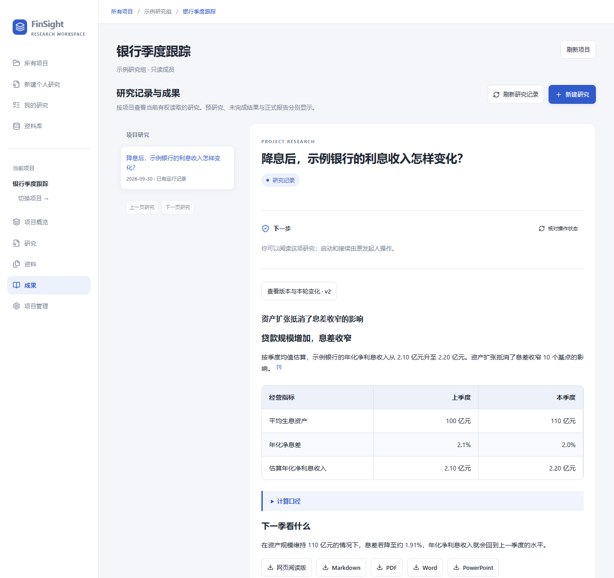
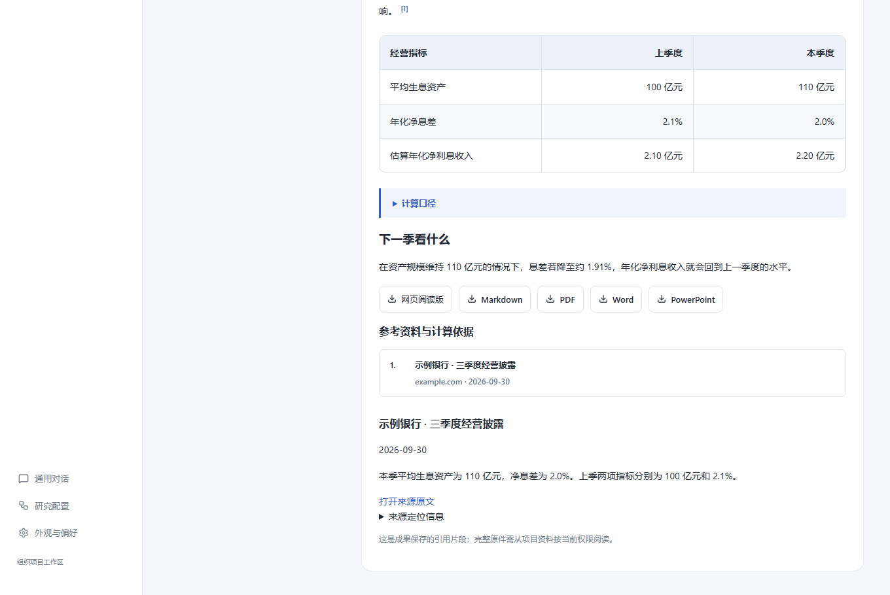

# FinSight Agent

FinSight is a self-hosted workspace for financial research. Add two quarterly filings to a project and ask why a bank earned more interest income as rates fell. Follow the investigation, open the disclosure behind a figure, and compare answers when the next filing arrives.

[中文](README.md) · [Quickstart](docs/public/quickstart.en.md) · [Architecture](docs/public/architecture.en.md) · [Example research skill](examples/skills/source-comparison/SKILL.md)



*Current workbench UI. The bank, disclosures and figures in both screenshots are illustrative.*

## Follow a finding back to the filing

For a comparison of two filings, attach them to a session and choose ordinary research. One investigator gathers evidence and drafts the report, followed by an independent review. For a comparison across banks, deep research can delegate deposit costs, loan mix and valuation to separate investigators. The lead brings their findings together. The workbench shows the models enabled in your deployment and the public progress of the investigation.

In the example, net interest margin fell from 2.1% to 2.0%, while average earning assets rose from 10 billion to 11 billion yuan. At those margins, estimated annualized net interest income rose from 210 million to 220 million yuan. Open the citation to check the inputs. If assets hold steady, a margin of about 1.91% would bring income back to its previous level. That gives the analyst a figure to watch next quarter.



Session attachments belong to the current investigation. Upload documents to the project library for future searches by authorized members. Compare report revisions or export the result as a web page, Markdown, PDF, Word or PowerPoint.

## Open the workbench locally

With Docker Compose and Python 3.10 or later installed, run these commands from the repository root.

```sh
python scripts/deployment/initialize.py
docker compose up -d --build
```

Open [Projects](http://127.0.0.1:8765/workspace/projects). The base installation provides project, document and account services. Live research requires the native execution service, your own provider credentials and a budget. See the guide for multi-user sign-in, model selection and retrieval setup. [Quickstart](docs/public/quickstart.en.md) · [Smoke test](scripts/dev/verify_public_checkout.py)
