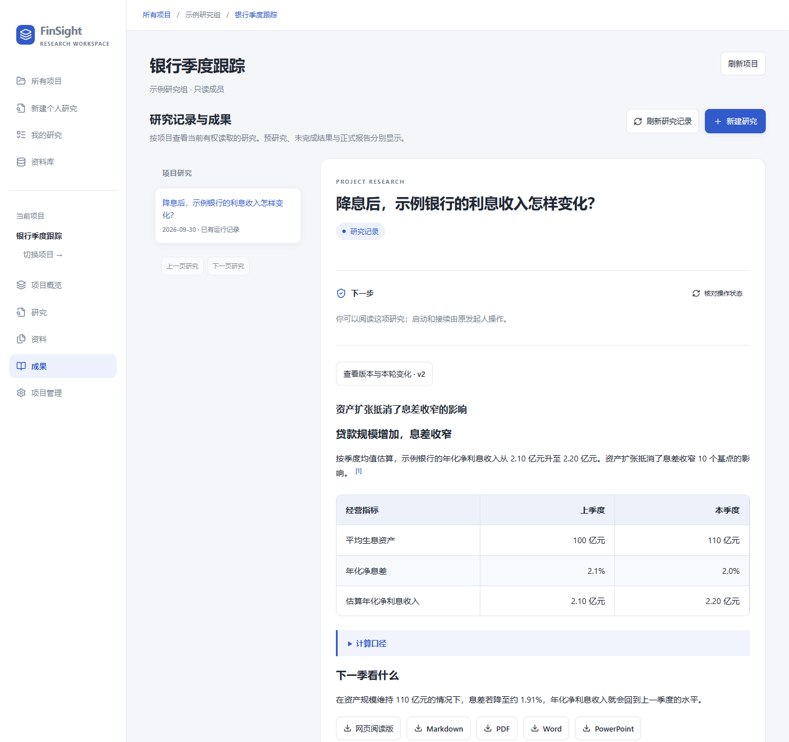
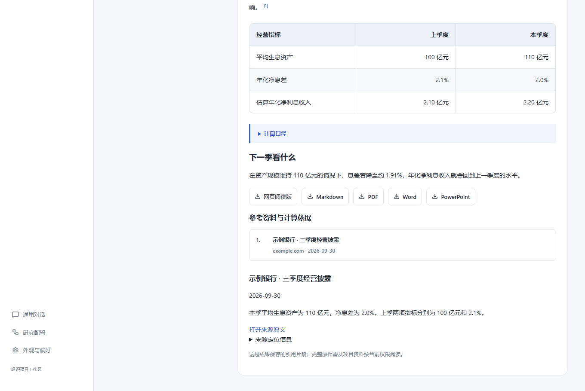

# FinSight Agent

FinSight 是一个可自部署的金融研究工作台。把两季财报放进同一个项目，问一句「降息后，这家银行的利息收入为什么还在增长？」。你可以跟踪研究者怎样取证，在报告里点开支撑判断的原文，也可以在下一季披露后追问，比较两版答案究竟改了什么。

[English](README.en.md) · [中文使用指南](docs/public/quickstart.zh-CN.md) · [系统架构](docs/public/architecture.zh-CN.md) · [研究方法示例](examples/skills/source-comparison/SKILL.md)



*当前工作台界面。两张图中的银行、披露和数字均为演示数据。*

## 从两份披露到一个可追问的判断

**先决定这次研究该做多深。** 有两份季报，只想核清利息收入变化，可以把文件附在研究会话中，选普通研究，由一位研究者取证、成稿，再独立复核。如果要比较多家银行的存款成本、贷款结构和估值，深度研究可以把这些关系分派给专题负责人，再由主负责人综合。工作台会显示当前部署可用的模型；研究者可以跟踪公开活动和工具进展。

**读报告时，顺着影响结论的数字查下去。** 示例银行的净息差从 2.1% 降到 2.0%，平均生息资产却从 100 亿元增到 110 亿元。用同一口径估算，年化净利息收入从 2.10 亿元升至 2.20 亿元。点击报告中的引用，就能核对两期数字来自哪段披露。若资产规模维持不变，下季息差降至约 1.91% 就会抵消这次增长，这给了下次追问一个具体起点。



**把下一次调查留在同一个项目。** 会话附件服务于当次任务；要供团队后续检索，可将材料上传到项目资料库。成员按权限查阅资料，报告保留版本和修改差异。阅读与交付可选网页、Markdown、PDF、Word 或 PowerPoint。

## 在本机打开工作台

准备 Docker Compose 和 Python 3.10 或更高版本，在仓库根目录运行：

```sh
python scripts/deployment/initialize.py
docker compose up -d --build
```

打开[项目工作台](http://127.0.0.1:8765/workspace/projects)。基础部署提供项目、资料和账户服务。要运行模型，按指南启用原生执行服务并配置自己的服务商密钥和预算。多人注册登录、组织模型组合及知识库索引也有独立的部署步骤。[启动与使用](docs/public/quickstart.zh-CN.md) · [本地快捷测试](scripts/dev/verify_public_checkout.py)
