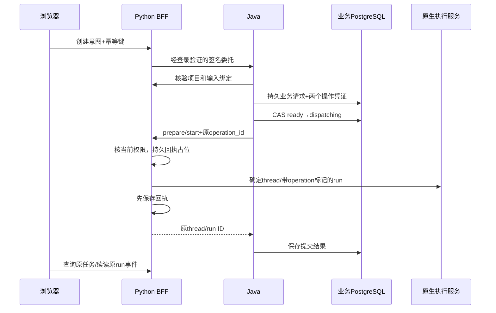

# Java接入请求生命周期与故障恢复（P0）

本批基于Java交付45cd5151；与研究/上下文维护分支隔离，首先复用已有能力再补独立验证。研究执行仍由原生Agent Server负责，Java不新增执行队列。组织项目research_enabled仍为false；本说明的研究接入限于既有个人项目。

2026-10-12当前状态：P0-A已完成前端修复、关联日志及对应回归；新增矩阵在一次完整复验中通过全部7组场景（1个集成测试，175.82s）。Java、BFF、PostgreSQL、SQLite、HTTP及进程终止都是真实的，原生执行SDK为磁盘持久化模拟。原生Agent服务宕机、真实停止竞态及企业登录等剩余边界见下表，不据此宣布完整P0或生产资格完成。

## 身份、状态与权威

2026-10-13 后续状态：共同版本已完成[真实原生服务的确定性图验收](java_native_lifecycle.zh-CN.md)，覆盖原生持久队列、强杀恢复与晚到停止。实际 Agent Server 对已结束 run 的 cancel 返回 404；BFF 现仅在 cancel 404/409 后读取原 thread/run，确认终态则返回 `cancel_requested=false`，不存在则 404，状态未明则 409，其他服务错误不吞掉、不自动重发。下文旧矩阵保留其当时模拟执行器的边界，不改写成原生证据。

| 标识或状态 | 权威/存储 | 含义 |
| --- | --- | --- |
| submission_key | Java research_task，按owner+key唯一 | 用户一次创建意图；正文摘要不同则409 |
| business task_id / native thread_id | Java请求+Python元数据+原生thread | 当前适配有意使用同一UUID；与专家task_id不同 |
| prepare/start operation_id | Java research_command + BFF SQLite回执 | 两阶段各一个永久操作标识，签名绑定请求，不能混用 |
| ready→dispatching→received/unknown/rejected | Java PostgreSQL | 派发与回执状态；received仅表示提交回执确认，不表示研究成功 |
| 原生run_id及pending/running/success/error/interrupted | Agent Server | 一次执行尝试；同一thread的修订/接续会生成新run |
| checkpoint_id / report_version / artifact digest | 原生checkpoint与版本存储 | 状态快照、报告版本、内容身份，各自独立；不能用最新run猜待核操作 |
| SSE event ID | 原生流保留记录 | 续读游标，只在对应thread/run中解释，不是报告版本 |



响应丢失不是失败证明。Java只允许ready首次派发；dispatching在外部显示unknown，重启也不回ready。reconcile只读BFF回执，或者确定thread和精确operation标记；无证据则继续unknown并提示人工核对。没有远程HTTP横跨数据库事务。Java before persistence 的请求还未被业务受理，故障后相同key可以显式重提；已持久化但实际零派发的unknown也不能凭“没看见run”自动重试。

强杀Java也不等于撤回已提交给PostgreSQL的SQL。本批行锁故障实测：Java的结果UPDATE等待行锁时终止Java，再释放行锁，PostgreSQL仍完成了autocommit写入。因此该窗口重启后可能是received，也可能仍是unknown；验收必须比对数据库状态、已保存回执和原run，不能规定“杀进程后一律unknown”。原生派发数仍必须是1，已确认结果必须对应原run。

## 取消、晚到和接续

2026-10-13 共同版本补充：[执行配置快照与技术接续](java_python_integration.zh-CN.md)。Java 接收并保存 `continuation_scope`，接续继承被接续 run 的执行选择；旧记录无快照采用明确兼容边界。原生服务宕机恢复仍未在本批验证。

取消仍走原有BFF `/research-sessions/{thread}/runs/{run}/cancel`，经owner/project检查后调用原生interrupt(wait=true)。返回cancel_requested表示已请求停止，不是强制写入业务cancelled。原生若已完成，以其实际终态为准；取消并不抹去已返回结果或未知供应商费用。取消中的同步模型工作线程允许记录已返回用量，但调用后的取消检查阻止继续执行其动作/再次派发。

浏览器关闭流/刷新只abort客户端读取，不调用cancel或start。重新打开读取同一个thread/run，流传Last-Event-ID（默认0-0）恢复仍保留的事件。事件不是研究状态唯一权威：任务面板只可用最新run事件补充当前任务，最终原生任务快照优先；旧run事件继续留在历史/费用视图。历史报告回读带checkpoint，修订目标带base_version；与模型对内容的实际修复效果分别验收。

明确接续生成新的原生run，复用已保存候选、观察与审查；失败调用/未知用量保留，不自动补发。本批不把离线脚本恢复或InMemorySaver模拟当作已验证原生Agent服务宕机恢复。

## 超时与重试边界

Java→Python：连接池等待3s、建连3s、响应20s，禁自动重试/重定向；浏览器网关BFF→Java建连3s、其余35s，禁自动重试。这些为各段上限，不是整个多阶段请求的总时限；客户端先超时仍可能已受理。无界自动重试次数为0。GET查询与reconcile可由用户显式触发；每次仍核权，后端不循环对账。原幂等创建可显式重提以取得原记录；不能换key绕过unknown。非法委托401，权限不可见404/管理不足403，格式422/400，内容或版本冲突409；网络/5xx/无效回执归unknown，不能靠重启清零。

关联日志只记录业务task/project/submission/operation/run UUID、phase与受控状态，不记录身份凭证、研究问题、文档正文或模型输入。Java在短事务返回后记录persisted，在成功抢占派发和写回状态后记录操作。Python模块`apps.workbench.backend.research_intake`使用标准INFO日志；验收fixture显式配置其handler，部署时也须在日志配置中启用该模块。未把全局日志级别强制改成DEBUG。数据库保存的原请求按原有数据权限管理；日志不是第二份执行状态库。

## 验证矩阵与停止条件

本批只运行合成执行器和离线测试，付费模型调用为0。P0全范围仍需区分BFF/Java进程故障、原生Agent服务故障以及真实登录供应商；P1在独立权限闭环未实现前继续禁用。

| 场景 | 验证层与结果 |
| --- | --- |
| 旧run迟到，同一专家task_id已进入新修订 | 新增浏览器用例先失败：任务板出现“旧运行完成内容/旧运行独有任务”；修复后显示“新修订等待执行”，刷新后仍一致，非GET请求计数0。旧事件保留在历史，不修改原始执行记录 |
| 浏览器提交响应丢失后刷新 | 既有浏览器用例通过：保留原提交键及原正文，不因刷新换键；项目/运行相关共10项通过 |
| Python回执进程在派发后死亡 | 既有独立进程测试通过：保留unknown，同键不二次执行；回执已保存但未发出响应时，可重放原回执 |
| 取消时模型线程返回 | 离线取消测试通过：保留已返回的123 token合成用量；动作被取消检查拒绝，下一次调用也被阻止。不是实际供应商取消或计费承诺 |
| 跨用户、当前资料访问撤销、输入版本变化 | BFF签名/回执用例通过：另一身份和撤权后的重放/状态查询404；输入变更拒绝启动、不偷偷换最新版。撤权在此层由stub模拟；不能替代组织研究权限闭环 |
| 候选提交校验失败后局部修复 | 离线脚本模型通过：保留原任务、观察、失败候选，累计模型轮次3→4；接续仅增加一次合成提交，不重跑前两次读取；跨任务/数据范围恢复被拒绝 |
| Java/PostgreSQL已有矩阵 | 本批13项通过：包含幂等并发、正文冲突、精确操作核对、授权与组织项目的既有范围；不是13个真实Agent服务故障场景 |
| 两进程重启后找回原run | 既有跨语言独立测试通过：实际BFF、Java、PG、SQLite与HTTP；仅原生SDK为磁盘fake |
| 新增故障点完整矩阵 | r3在一次完整运行中通过下列7组，包含直接读取PG状态/响应与原run逐项对照、反复核对不重复派发、日志关联及敏感正文不输出；前两轮失败独立保留，不拼接局部结果充当通过 |
| 原生Agent Server进程宕机、真实停止与完成同时发生 | 本批未运行；BFF模拟执行器不能证明原生服务故障恢复 |
| 真实OIDC登录、组织撤权到报告/接续全链路、真实模型研究质量 | 本批未验收，组织项目research_enabled=false；不宣称企业多人研究平台已落地 |

Python定向回归48项通过，包括回执跨进程、取消、恢复和研究会话协议。新增INFO日志保护后，又复验5项Java适配BFF用例通过；追加日志身份关联/正文与凭证不输出断言后再验5项通过。这5项包含在48项中，不重复累计。前端类型检查和构建通过，构建保留现有大chunk警告。

新增矩阵的逐项实际结果如下。`received`表示原操作接收得到确认，不是金融研究结论正确；派发数来自合成执行器持久记录。

| 故障或请求 | 恢复后的实际状态 | 核对结果与派发数 |
| --- | --- | --- |
| 20次同键创建 + 20次同任务启动 | 1个业务任务、1个thread | 1次派发；同键不同正文409 |
| Java在项目绑定校验期间、业务请求写入前终止 | 原HTTP 503；用户以原键显式重提后准备完成 | 0次研究派发；未受理请求可明确重提 |
| Python在调用原生执行器前终止 | PG与API均unknown；核对后仍unknown | 0次派发；不以“未发现run”为由自动补发 |
| Python在模拟run落盘后、BFF回执保存前终止 | unknown→received | 找回原run，派发保持1 |
| Python在BFF回执保存后、HTTP响应发出前终止 | unknown→received | 读取原回执与run，派发保持1 |
| Java在发出start、Python模拟run落盘后终止 | PG保留dispatching，API显示unknown；核对后received | 精确操作关联原run，派发保持1 |
| Java已提交结果UPDATE、等待行锁时终止 | 释放行锁后PG写入received；重启API也为received | PG响应、API响应与原run一致，派发保持1 |

最后一行允许的合同结果是unknown或received，必须与实际PG状态相符；本次实际为received。五个启动中断场景在显式start和三次reconcile之后再次检查计数，未新增run。这个结果不等于分布式exactly-once，也不是多Agent吞吐压测。

保留的失败记录：r1最后一行错误预设“杀Java必为unknown”，由真实PG行为推翻，随后修正验收合同并增加直接SQL对照；r2运行中发生C盘耗尽、日志异常与Docker API超时，验收与清理均受阻；r3恢复引擎、把产物转到有余量的盘后完整通过。测试现为Docker CLI设置60s、pg_isready设置10s上限，保存容器ID，清理失败时写`cleanup-required.json`，避免无限等待。

## 可重复执行与证据

先安装根目录声明的Python测试依赖，JDK21、Docker和前端锁定依赖。以下均使用本次checkout，不指向开发者私有数据或运行中的研究服务。

```powershell
# 仓库根目录：纯离线与回执进程回归
uv run --no-sync python -m pytest -q tests/test_java_research_intake.py tests/test_submission_receipts.py tests/test_submission_receipts_processes.py tests/test_research_cancellation.py tests/test_research_recovery.py tests/test_report_session.py

# apps/business-service：自己的临时PostgreSQL
./mvnw.cmd verify

# 回到仓库根目录：真实HTTP、签名、数据库和实际进程终止；原生执行仍是磁盘fake
$env:FINSIGHT_INTAKE_TEST_JAR=(Resolve-Path apps/business-service/target/business-service-0.1.0.jar).Path
# java/docker默认使用PATH，也可设置FINSIGHT_TEST_JAVA / FINSIGHT_TEST_DOCKER
uv run --no-sync python -m pytest -q tests/integration/test_java_intake_faults.py tests/integration/test_java_intake_stack.py --basetemp .local/intake-faults --junitxml .local/intake-faults.xml

# apps/workbench/frontend：先构建，再启动隔离preview；API均由静态fixture提供
npm run build
npx playwright test --config playwright.recovery.config.ts
```

每次复验使用新的`--basetemp`路径，以保留前次失败证据；空间不足时将basetemp、JUnit输出和TEMP/TMP设到有足够余量的盘。跨语言故障用例将`fault-matrix.json`、各次Java/BFF日志、SQLite回执和合成native状态保存在该目录的测试子目录中。矩阵包含submission_key、task_id、operation_id、原run_id、故障前后状态和派发次数。进程强杀仅限本用例启动的PID；容器清理核对本用例返回的ID及qualification label，不操作已有容器。测试fixture必须显式设置qualification开关，不可部署。

定位一次请求时：从页面取得业务task ID，在`research_task`查submission_key，在`research_command`区分prepare/start操作；以operation_id关联BFF回执，再取得确定的原run。不要把专家task_id、最新run或报告版本当作同一个标识。该链路仍是业务身份关联，并未引入分布式tracing系统。

## 三个能自己复述的错误场景

1. **旧事件为什么不能覆盖新修订？** 第一次研究和第二次修订可能复用同一专家task_id。如果只按task_id和消息到达时间更新界面，第一次的晚到消息会把第二次的待处理任务标成旧结果。任务板必须把run_id作为归属条件；保留历史不等于把历史当作当前状态。
2. **幂等键为什么还需要核对？** Java把请求发出后断线，无法知道Python是否已创建run。幂等键能防止业务请求重复，不能让两个数据库和HTTP瞬间形成一个事务。此时记录unknown，查询原回执/原操作标记；找不到证据就继续待核，不能因为想显示成功而重跑。代价是少量零派发请求也会需要人工处理，这是明确的保守边界。
3. **点击停止后为什么还会有结果或费用？** 停止请求发出时，原生运行或模型调用可能已经完成。停止表示请求中断后续工作，不能倒退已发生的调用；最终状态以原生run为准，用量照实保留。若同时产生了新修订，旧run完成消息只进入旧历史，不能覆盖当前任务。

这些结论证明的是对应层的工程行为。离线模型轮次、合成派发数和浏览器操作次数都不是实际研究吞吐、真实模型成本收益或金融结论正确性。
