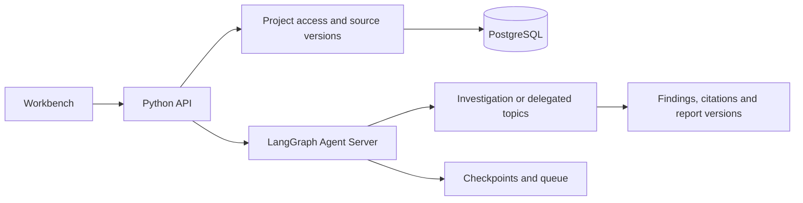

# FinSight architecture

For example, preparing a quarterly review binds the authorized filing versions to an execution. A local BM25 search can open a passage before the first model call. Starting the research then creates a native run. A reader opening a citation later must still have access to the bound source. [Try the retrieval path](quickstart.en.md#knowledge-base-and-retrieval-setup)

React and Vite provide the project, conversation, research, library and report views. A same-origin Python API coordinates browser sessions with the Java business service. Spring and PostgreSQL maintain project roles, source versions and authorized operations. The server checks the current identity when it serves a protected resource.

LangGraph Agent Server executes research and stores checkpoints, using PostgreSQL and Redis. In deep research, a lead assigns topics and incorporates versioned findings with their evidence. The author can retrieve the source passage behind an adopted finding while drafting. Reports retain citation identity across chapter edits.

The DeepSeek Harness integration uses ACP. The activity view consumes public progress messages and tool status. Provider credentials, private transcripts, uploaded documents and built indexes belong to the deployment. Document search can use BM25 and configured embedding and reranking providers.

## Research configuration

Organization runs bind the current task ID, research cutoff and selected topics to the method defaults in `configs/research/task_method_defaults.json`. For an archived case, supply its original foundation file to the loader. The standalone method reader also accepts `FINSIGHT_RESEARCH_FOUNDATION_PATH`.

The retrieval kernel supplies evidence slots, industry vocabulary and candidate limits. For a case-specific retrieval snapshot, pass a kernel with your dated subjects and related entities using `--kernel`. The workbench source-intake service starts with an empty route list. Set `FINSIGHT_SOURCE_INTAKE_POLICY` to a local policy file to enable specific original-document capture routes.
